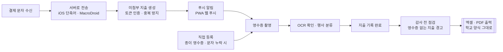

# 학생회 회계·감사 도구 MVP PRD

최종 수정: 2026-11-23 · 원본: [Claude 문서](https://claude.ai/artifact/M6gQWo9r2qkwuuj6DBNvaL)

## 개요

학생회 총무가 결제 즉시 영수증을 남기고, 감사 시즌에는 버튼 한 번으로 정해진 엑셀 양식과 증빙 PDF를 받는 웹 서비스(PWA)를 만든다.

**문제**

- 학생회는 분기 또는 반기마다 학생회비 사용 내역 감사를 받는다.
- 총무는 회식, MT, 행사 영수증을 모아 학교가 정한 엑셀 양식에 손으로 옮겨 적는다.
- 영수증은 감사 직전에 몰아서 정리하기 때문에 분실, 금액 오기, 누락이 자주 생긴다.
- 기수가 바뀌면 이전 장부와 증빙이 흩어져 인수인계가 어렵다.

**제품 한 줄 소개**

결제 문자가 오면 영수증 첨부를 요청하고, 쌓인 기록을 감사 양식 엑셀과 증빙 PDF로 자동 출력하는 학생회 회계 도구.

**MVP 범위**

공통 기반(로그인, 조직, 권한, 기수), 지출 등록과 영수증 OCR, 감사 엑셀 자동 생성과 증빙 PDF, 결제 문자 연동. 통장 대조, 예산, 정산, 행사, 회비, 물품은 MVP 이후 단계로 미룬다.

## 목표와 성공 지표

MVP의 목표는 다음 감사 시즌 한 번을 이 도구만으로 준비해 내는 것이다.

| 목표 | 성공 지표 | 목표값 |
| --- | --- | --- |
| 감사 준비 시간 단축 | 엑셀·증빙 자료 준비에 드는 시간 | 기존 대비 70% 이상 감소 (기존 소요 시간은 총무 인터뷰로 확인) |
| 영수증 누락 방지 | 결제건 중 영수증이 첨부된 비율 | 95% 이상 |
| 즉시 기록 습관 | 결제 후 24시간 안에 영수증이 첨부된 비율 | 80% 이상 |
| OCR 정확도 | 날짜·금액을 수정 없이 통과한 비율 | 90% 이상 |
| 감사 통과 | 자동 생성한 엑셀을 수정 없이 제출 | 감사 1회 제출 완료 |

**비목표 (MVP에서 하지 않는 것)**

- 통장 거래내역 자동 대조, 예산 편성·사용률 관리
- 개인 선결제 정산 워크플로
- 행사·참가비, 학생회비 납부, 물품 대여, 결산 공개 페이지
- 회의록·공문 보관 (노션으로 대체)
- 여러 학교 양식 지원: MVP는 우리 학교 양식 하나만
- 안드로이드·iOS 네이티브 앱, 실제 송금·카드사 API 연동

## 사용자와 역할

핵심 사용자는 학생회 카드를 들고 감사 자료를 만드는 총무 한 명이다.

| 역할 | 하는 일 | 권한 |
| --- | --- | --- |
| 총무(회계) | 결제, 영수증 등록·수정, 감사 자료 출력, 결제 문자 연동 설정 | 지출 전체 읽기·쓰기·삭제, 엑셀·PDF 출력, 연동 토큰 관리 |
| 회장 | 지출 현황 확인, 멤버 초대, 기수 전환 | 지출 읽기, 멤버·역할 관리, 기수 전환 |
| 집행부원 | 행사 때 대신 받은 영수증 올리기 | 지출 등록(본인 건만 수정), 읽기 |

**페르소나: 총무 김총무 (가상)**

- 3학년, 학생회 카드와 통장을 맡고 있음
- 행사가 있는 달에는 결제가 30건 넘게 생김
- 영수증을 지갑이나 학생회실 상자에 모아 두다가 감사 1주 전에 몰아서 엑셀에 옮김
- "어느 영수증이 어느 행사 건지" 다시 기억해 내는 데 가장 시간이 많이 듦

**핵심 사용 시나리오**

1. **결제 직후:** MT 장보기에서 학생회 카드로 152,000원을 결제한다. 1분 안에 "○○마트 152,000원, 영수증을 첨부해 주세요" 푸시가 온다. 눌러서 영수증을 찍고 행사를 "MT"로 고른다.
2. **뒤늦게 등록:** 집행부원이 받아 온 종이 영수증을 총무가 찍어 올린다. OCR이 날짜·가맹점·금액을 채우고, 총무는 확인만 한다.
3. **감사 준비:** 감사 기간을 고르고 "영수증 없는 결제 2건" 경고를 확인해 정리한다. 감사 엑셀과 증빙 PDF를 내려받아 그대로 제출한다.
4. **기수 전환:** 임기가 끝나면 회장이 다음 기수를 만들고 새 총무를 초대한다. 지난 기수 기록은 읽기 전용으로 남는다.

## MVP 기능 요구사항

MVP는 4개 모듈, 20개 요구사항으로 구성한다. P0는 없으면 출시하지 않고, P1은 일정이 밀리면 2차로 넘긴다.

### 1. 공통 기반

| ID | 요구사항 | 우선순위 |
| --- | --- | --- |
| F-01 | 구글·카카오 소셜 로그인 | P0 |
| F-02 | 학생회(조직) 생성: 학교명, 단체명(예: ○○학과 학생회) | P0 |
| F-03 | 초대 링크로 멤버 초대, 역할 지정(총무·회장·집행부원) | P0 |
| F-04 | 기수 관리: 기수(예: 2026년 제38대)별로 데이터 분리, 지난 기수는 읽기 전용 | P0 |
| F-05 | 행사/항목 카테고리 관리(회식, MT, 축제, 비품 등), 감사 양식의 항목과 매핑 | P0 |

### 2. 지출·영수증·OCR

| ID | 요구사항 | 우선순위 |
| --- | --- | --- |
| F-06 | 지출 등록: 날짜, 가맹점, 금액, 품목, 결제수단(학생회 카드/계좌이체/현금), 행사, 메모 | P0 |
| F-07 | 영수증 이미지 촬영·업로드(한 지출에 여러 장), 업로드 전 자동 리사이즈 | P0 |
| F-08 | OCR로 날짜·가맹점·금액·품목 추출 후 폼에 미리 채우기, 인식이 불확실한 칸 표시 | P0 |
| F-09 | 지출 목록: 기간·행사·영수증 유무로 필터, 합계 표시 | P0 |
| F-10 | 지출 수정·삭제 이력 기록(누가 언제 무엇을 바꿨는지) | P1 |
| F-11 | 영수증 분실 시 사유서 작성(감사 양식에 포함) | P1 |

### 3. 감사 엑셀·증빙 PDF

| ID | 요구사항 | 우선순위 |
| --- | --- | --- |
| F-12 | 학교 감사 양식(.xlsx)을 템플릿으로 등록, 셀 위치·항목 매핑은 MVP에서는 코드로 고정 | P0 |
| F-13 | 감사 기간 선택 후 양식에 지출을 채워 .xlsx 다운로드(서식·수식 유지) | P0 |
| F-14 | 증빙 PDF: 영수증 이미지를 엑셀 번호 순서로 묶고, 각 페이지에 번호·날짜·금액 표시 | P0 |
| F-15 | 출력 전 점검: 영수증 없는 지출, 행사 미분류, 금액 0원 등 경고 목록 | P0 |

### 4. 결제 문자 연동

| ID | 요구사항 | 우선순위 |
| --- | --- | --- |
| F-16 | 결제 수신 API(웹훅): 학생회별 비밀 토큰으로 인증, 문자 원문을 POST 본문으로 받음 | P0 |
| F-17 | 결제 문자 해석: 금액·가맹점·승인 시각·승인/취소 구분, 학생회 카드사 1곳 형식 우선 | P0 |
| F-18 | 해석된 결제로 "영수증 미첨부" 지출 자동 생성, 같은 결제 중복 수신 방지 | P0 |
| F-19 | 웹 푸시 알림(PWA): 결제 수신 즉시 총무에게 발송, 누르면 해당 지출의 영수증 첨부 화면 | P0 |
| F-20 | iOS 단축어 설치 링크와 설정 안내, 최근 수신 기록 화면(연동이 동작하는지 확인용), 안드로이드는 MacroDroid 설정 안내 | P1 |

## 화면 구성과 사용자 흐름

결제 문자로 자동 생성된 지출과 직접 등록한 지출은 모두 영수증 촬영 단계에서 만나 같은 경로로 감사 출력까지 간다.

자동 경로가 실패해도 직접 등록으로 같은 흐름에 합류하므로, 문자 연동은 필수가 아닌 편의 기능이다.

| 화면 | 주요 내용 | 주 사용자 |
| --- | --- | --- |
| 온보딩 | 로그인, 학생회 생성 또는 초대 수락, 홈 화면 추가·푸시 허용 안내 | 전체 |
| 홈(대시보드) | 이번 기수 지출 합계, 영수증 미첨부 건수, 최근 지출 5건, 등록 버튼 | 전체 |
| 지출 목록 | 기간·행사·영수증 유무 필터, 합계 | 전체 |
| 지출 등록·상세 | 영수증 촬영, OCR 결과 확인·수정, 행사 선택, 메모 | 총무, 집행부원 |
| 감사 준비 | 감사 기간 선택, 점검 결과, 엑셀·증빙 PDF 다운로드 | 총무 |
| 결제 연동 설정 | 토큰 발급·폐기, 단축어 설치 링크, 최근 수신 기록 | 총무 |
| 학생회 설정 | 멤버 초대·역할, 행사 카테고리, 기수 전환 | 회장, 총무 |

## 데이터 모델

모든 데이터는 학생회 → 기수 아래에 달리고, 행 단위 접근 제어(RLS)로 소속 학생회 데이터만 보인다.

| 테이블 | 주요 필드 | 관계 |
| --- | --- | --- |
| users | id, 이름, 이메일, 로그인 제공자 | — |
| organizations | id, 학교명, 단체명, 생성일 | 학생회 1 : N 기수 |
| terms | id, organization_id, 이름(제38대), 시작일, 종료일, 활성 여부 | 기수 1 : N 멤버십·지출 |
| memberships | user_id, term_id, 역할(treasurer/president/member) | 사용자 N : N 기수 |
| categories | id, term_id, 이름(MT, 회식), 감사 양식 항목 코드 | 카테고리 1 : N 지출 |
| expenses | id, term_id, category_id, 날짜, 가맹점, 금액, 품목, 결제수단, 상태(영수증 미첨부/완료/사유서), 메모, 등록자, payment_event_id | 지출 1 : N 영수증 |
| receipts | id, expense_id, 이미지 경로, OCR 원문(JSON), OCR 신뢰도 | — |
| payment_events | id, organization_id, 문자 원문, 해석 결과(금액·가맹점·시각·승인/취소), 수신 시각, 중복 키 | 결제 이벤트 1 : 1 지출 |
| webhook_tokens | id, organization_id, 토큰 해시, 마지막 사용 시각, 폐기 여부 | — |
| push_subscriptions | user_id, 엔드포인트, 키 | — |
| audit_logs | id, expense_id, 변경자, 변경 전·후 값, 시각 | P1(F-10) |

- 금액은 원 단위 정수로 저장한다.
- 결제 취소 문자는 원래 지출을 "취소" 상태로 바꾸고 감사 엑셀에서 뺀다.

## 비기능 요구사항

학생회비는 학생들의 돈이므로 보안과 기록 보존을 기능보다 우선한다.

| 구분 | 요구사항 |
| --- | --- |
| 접근 제어 | 모든 테이블에 RLS 적용, 역할별 권한은 서버에서 검사 |
| 웹훅 보안 | 토큰은 해시로만 저장, 재발급·폐기 가능, HTTPS만 허용, 분당 요청 수 제한 |
| 개인정보 | 문자 원문에서 카드번호·이름 일부는 저장 전 마스킹, 원문은 URL에 넣지 않음 |
| 파일 보관 | 영수증 이미지는 비공개 스토리지, 서명된 URL(유효시간 10분)로만 조회 |
| 데이터 보존 | 지출은 삭제 대신 소프트 삭제, 지난 기수 데이터는 읽기 전용으로 최소 5년 보관, 주 1회 백업 |
| 성능 | 결제 문자 수신 후 푸시까지 10초 이내, OCR 결과 5초 이내, 엑셀 생성(지출 300건) 10초 이내 |
| 호환성 | 모바일 우선 반응형, iOS Safari 16.4 이상(홈 화면 추가 시 푸시), 안드로이드 Chrome, PC Chrome·Edge |
| 비용 | 월 운영비 1만 원 이하(무료 플랜 + OCR 사용량 과금) |

## 기술 스택 제안

1인 개발과 무료 호스팅을 기준으로 Next.js + Supabase 조합을 제안한다. 개발자가 익숙한 스택이 있으면 그쪽을 우선한다.

| 영역 | 선택 | 이유 |
| --- | --- | --- |
| 프론트엔드 | Next.js(App Router) + TypeScript + Tailwind CSS | 화면과 API를 한 프로젝트에서 관리 |
| PWA·푸시 | Web App Manifest + Service Worker + Web Push(VAPID) | 앱 설치 없이 홈 화면 추가와 푸시 |
| 백엔드·DB | Supabase(PostgreSQL, Auth, Storage, RLS) | 로그인·DB·파일 저장을 한 번에, 무료 플랜 |
| OCR | 1안: 네이버 CLOVA OCR 영수증 모델 / 2안: Claude 비전 API로 구조화 추출 | 2주차에 실제 영수증 30장으로 비교 후 결정 |
| 결제 문자 해석 | 카드사별 정규식, 실패 시 LLM으로 추출 | 정규식은 빠르고 무료, LLM은 형식 변화에 강함 |
| 엑셀 | ExcelJS(원본 양식 파일을 열어 셀 값만 채움) | 서식·병합·수식 유지 |
| PDF | pdf-lib | 이미지 배치와 페이지 번호 출력 |
| 배포 | Vercel(무료 플랜) | Next.js 배포가 간단, HTTPS 기본 |
| 모니터링 | Sentry(무료 플랜) | 웹훅·OCR 실패 추적 |

## 일정과 마일스톤

개발 시작 후 8주 안에 MVP를 출시하고, 다음 감사 최소 2주 전에는 실사용을 시작한다. (주 15~20시간, 1인 개발 기준 · 시작일은 감사 일정 확인 후 확정)

| 작업 | 기간 |
| --- | --- |
| 요구사항·양식 확보 | 1주차 (관문: 감사 양식 확보) |
| 공통 기반(로그인·기수) | 1–2주차 |
| 지출·영수증 등록 | 2–3주차 |
| OCR 비교·연동 | 3–4주차 |
| 감사 엑셀·증빙 PDF | 4–5주차 (관문: 실제 양식으로 출력 검증) |
| 결제 문자·푸시 연동 | 5–6주차 |
| 총무 베타 테스트 | 7주차 |
| 버그 수정·출시 | 8주차 (관문: MVP 출시) |

5주차 관문에서 실제 양식으로 만든 엑셀이 통과하지 못하면 결제 문자 연동을 2차로 미루고 엑셀 출력에 집중한다.

**MVP 이후 로드맵**

| 단계 | 기능 | 시작 조건 |
| --- | --- | --- |
| 2차 | 통장 거래내역 대조, 예산 편성·사용률, 개인 선결제 정산 | MVP로 감사 1회 제출 완료 |
| 3차 | 행사·참가비, 학생회비 납부, 물품 대여, 결산 공개 페이지 | 다른 학생회 1곳 이상 도입 의사 |
| 포털 확장 | 공지, 행사 일정, 여러 학교 양식 매핑 화면 | 3차 이후 사용자 피드백 |

## 리스크와 미결 사항

가장 큰 리스크는 감사 양식과 제출 규정을 아직 모른다는 점이다. 1주차 안에 확인해야 한다.

| 리스크 | 영향 | 대응 |
| --- | --- | --- |
| 감사 양식이 복잡하거나 매 학기 바뀜 | 엑셀 자동 생성 지연 | 양식을 먼저 확보하고, 매핑을 설정 파일로 분리해 코드 수정 없이 바꿀 수 있게 함 |
| 실물 영수증 원본 제출 의무 | 증빙 PDF 가치 하락 | 원본 보관용 번호 라벨 출력으로 방향 전환 |
| OCR이 구겨진·흐린 영수증을 잘못 읽음 | 확인 수고 증가 | 불확실한 칸 강조, 결제 문자 금액과 교차 검증 |
| iOS 단축어 자동화가 조용히 실패 | 결제건 누락 | 최근 수신 기록 화면, 주 1회 "수신 없음" 알림, 수동 등록 경로 유지 |
| 카드사 문자 형식 변경 | 해석 실패 | LLM 추출로 대체, 해석 실패 건은 총무에게 원문 표시 |
| 개발 일정 지연(시험 기간 등) | 감사 시즌 놓침 | P1 기능부터 2차로 미룸, 6주차에 범위 재점검 |
| 학생회 기수 교체 | 사용자 이탈 | 기수 전환 기능을 P0로 두고, 인수인계 안내문 제공 |

**미결 사항**

- [ ] 실제 감사 엑셀 양식 파일 확보 (개인정보 제거본)
- [ ] 감사 주기와 다음 감사 날짜 확인 → MVP 마감일 확정
- [ ] 제출 방식: 엑셀만 / 영수증 사본 / 실물 원본
- [ ] 학생회 카드사와 결제 문자 예시 확보 (개인정보 가림)
- [ ] 총무 휴대폰 기종(iOS/안드로이드)
- [ ] 개인 선결제·현금 지출 비중 (많으면 정산 기능을 앞당김)
- [ ] 총무 인터뷰: 기존 감사 준비에 드는 시간
- [ ] 개발자 주당 가용 시간과 익숙한 스택
